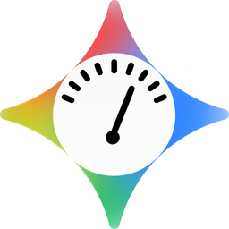
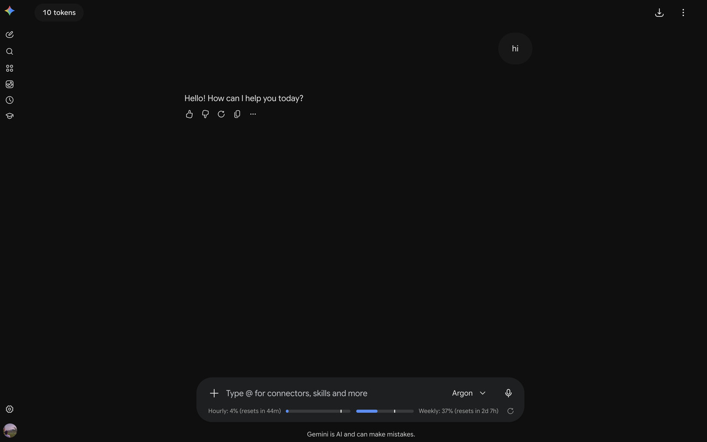
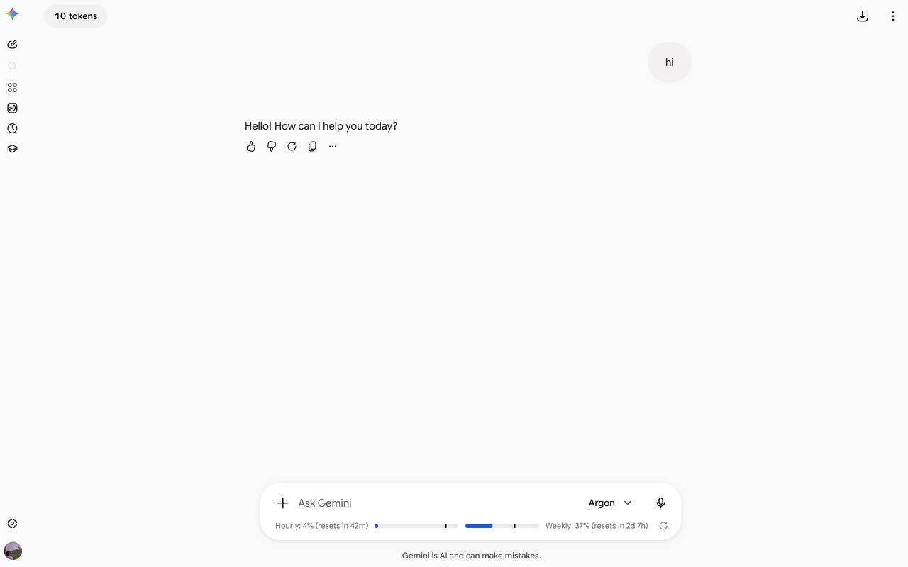
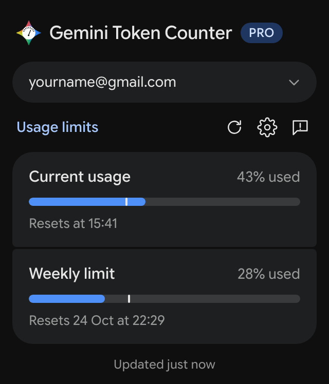
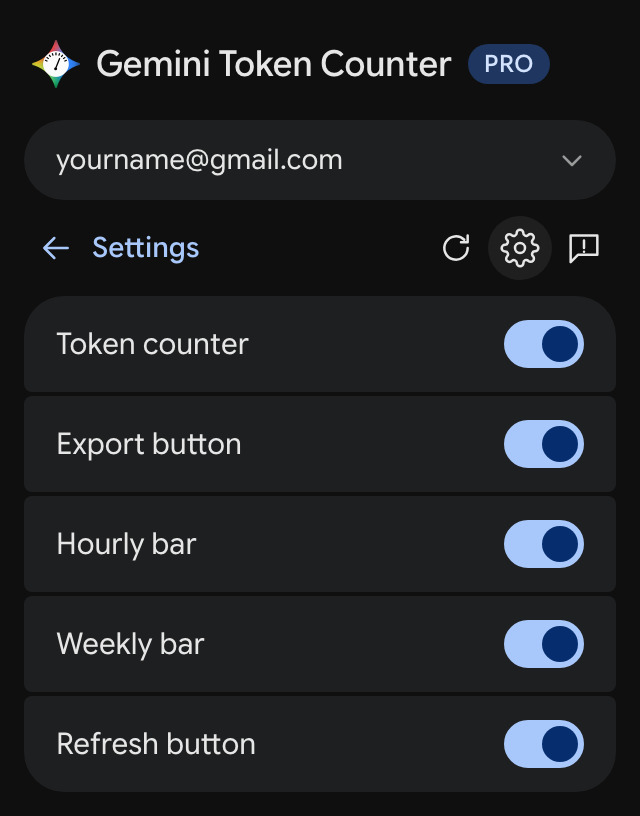
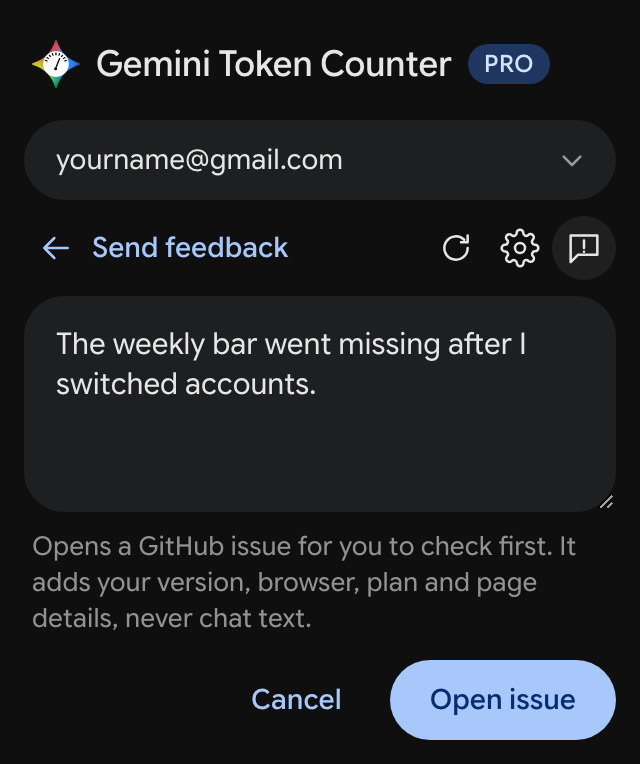

<p align="center">
  
</p>

<h1 align="center">Gemini Token Counter</h1>

<p align="center"><b>A minimal browser extension that shows a live token count and Gemini's own usage limits on gemini.google.com, exports any conversation to Markdown or plain text, and puts your limits one click away from any tab</b></p>

<p align="center"><sub>An independent project. Not affiliated with, endorsed or sponsored by Google. Gemini and Google Sans are trademarks of Google LLC.</sub></p>

## Features

- **Token count**: approximate token count for the open chat, in a pill at the top left of the conversation, drawn like Gemini's own buttons. Click it for a table of each Gemini model's context window on each plan
- **Usage bars**: the 5-hour ("Hourly") and weekly limits from Gemini's own usage data, the same figures its [usage page](https://gemini.google.com/usage) shows, with reset countdowns. They sit inside the input box, which grows to hold them. Bars turn amber at 75% and red at 90%. A thin line marks how far through the window you are, so you can see whether you are using your allowance faster than the clock
- **Hover help**: every control explains itself in a tooltip drawn as Gemini draws its own, and the icons are Gemini's own glyphs
- **Chat export**: download the open conversation as Markdown or plain text, including the documents Gemini wrote (Canvas, Deep Research reports) and the names of files you attached
- **Toolbar popup**: click the extension icon from any tab for your limits, with a switch for each part of the extension and a one-click bug report
- **Every account**: free and paid plans, and every signed-in Google account (`/u/0`, `/u/1`, …), each with its own figures

The extension requests a single permission, `storage`. It runs on gemini.google.com and nowhere else, so that is the only site the browser lists it as able to access. The popup asks for its own access to gemini.google.com only if you press refresh there.

## Screenshots

| Dark | Light |
| --- | --- |
|  |  |

The toolbar popup: your limits from any tab, a switch for each part, and a prefilled bug report.

| Usage limits | Settings | Send feedback |
| --- | --- | --- |
|  |  |  |

## Installation

**Chromium** (Chrome, Edge, Brave, Opera, Vivaldi, Arc, and any other Chromium-based browser; version 111 or later)

1. Download or clone this repository.
2. Open the browser's extensions page (`chrome://extensions` on Chrome, `brave://extensions` on Brave, `edge://extensions` on Edge, or the equivalent for your browser) and turn on **Developer mode**.
3. Click **Load unpacked** and pick the repository folder.
4. Reload any Gemini tab that was already open: a tab open before install is not reached until it is reloaded.

Firefox is not supported.

## How it works

The extension has two halves that run in two different JavaScript worlds, because the token Gemini's own requests carry is only visible to the page itself, not to a normal content script.

**1. The page-world bridge (`src/injected/bridge.js`)**

This script runs in the page's own execution context (the "main world"), not the isolated content script sandbox. The manifest declares it with `"world": "MAIN"` and `"run_at": "document_start"`, so it is in place before Gemini's first script and keeps the browser's own `fetch`, not a wrapper Gemini adds later.

Gemini's web app talks to its server through one endpoint, `/_/BardChatUi/data/batchexecute`, with a named RPC per request and the page's CSRF token (`WIZ_global_data.SNlM0e`). The bridge makes two of those calls, the same ones Gemini's own pages make, and nothing else:

- `jSf9Qc`: your usage limits, exactly what Gemini's usage page asks for.
- `hNvQHb`: a conversation's turns, newest first, 50 to a page, following the page token. A long chat stops at 40 pages or 45 seconds and says it is partial, rather than running into the content script's timeout and showing nothing.

The token rotates during a long session, so it is read fresh on every call. Signed into more than one Google account, the bridge uses the account of the page you are on (`/u/1/…`). Gemini's answers are length-prefixed chunks whose lengths cannot be trusted to slice by, so the bridge finds each JSON array by bracket matching instead.

Because the bridge runs in the page's own world, it cannot call extension APIs, and the content script cannot call anything the bridge defines. The only channel between them is `window.postMessage`, tagged `gc: 'GeminiCounter'` and matched by request id. The bridge answers its own two requests and no others, and checks a conversation id is the hex id Gemini itself uses before it goes into a request.

**2. The content script (`src/content/*.js`)**

Runs in the isolated content script world, declared in `manifest.json` against `https://gemini.google.com/*`. It is responsible for everything you see:

- `bridge-client.js` sends the bridge its requests and matches the replies.
- `main.js` orchestrates state. It takes the open chat's id from the address (`/app/<id>`, or `/gem/<gem>/<id>` inside a Gem), reads the plan from the sidebar's account chip ("Pro", "Ultra", "Plus", or none for no plan), and decides when to read usage and the conversation again. Gemini moves between chats without reloading the page, so the address is checked once a second.
- `conversation.js` turns Gemini's positional arrays into turns: your prompt, the names of files you attached, the reply Gemini chose, and the documents it wrote. Every field is read defensively, so a moved field reads as missing instead of breaking the page. The count runs prompts, replies and documents through a vendored `o200k_base` tokenizer (`src/vendor/o200k_base.js`). That is OpenAI's encoding, not Gemini's own, so the count is approximate and lower than Gemini's real figure, which also includes uploaded files, images, thinking and its own instructions.
- `ui.js` renders the chip, the usage row, the export button and its menu, the context popover, and the shared tooltip. Colours are Gemini's own design tokens (`--lumi-sys-*`, `--gem-sys-*`), which Gemini sets on the page and switches itself for light and dark, so the extension follows Gemini's theme with no code of its own. The fonts are Gemini's (Google Sans Flex, in the same narrow cut), and the icons are glyphs from Gemini's own icon font once it has loaded.
- `export.js` turns a conversation into a Markdown or plain text document, saved through a blob URL, so no `downloads` permission is needed.
- `src/popup/*` is the toolbar popup, built like a page of Google's own settings, with Google Sans Flex bundled so it has Gemini's typeface even off Gemini. It is a separate document and cannot read the content script's memory, so the content script mirrors each account's usage reading into `chrome.storage.local` under its own key and the popup renders the chosen account's snapshot with its age. It loads `src/content/constants.js` too, so the storage keys, settings and parsing rules exist once and are shared.

**3. Usage bars specifically**

Gemini reports each limit as a fraction used and a reset time. Kind 1 is the 5-hour window Gemini calls "Current usage", kind 2 the weekly limit, and the figures are shown as whole percentages, as Gemini's usage page shows them. Free accounts get real figures too.

They are read when the page loads, after every reply, every 5 minutes while the tab is visible, and whenever you press refresh. The end of a reply is taken from the page itself: Gemini marks a reply in progress with `aria-busy="true"`, an attribute rather than words, so it holds in every language. The flag dips for a moment as a reply starts, so the end is the flag staying down for over a second. The conversation is then read again, and once more shortly after if the server does not have the new turn yet.

Gemini's windows do not wait for a message to start, unlike Claude's. They are a fixed grid that rolls on whether or not you chat: the 5-hour window resets every 5 hours on the dot, and the weekly one on the same grid. So when a window ends, the bar moves straight into the next one at 0% and reads usage again to confirm it, instead of going blank until your next message.

Each bar carries a thin line showing how far through its window the clock has travelled, which is what makes the fill readable: 40% used one hour into a five-hour window means something different from 40% used with ten minutes to go. Gemini does not say how long a window is, so its start is inferred by subtracting the nominal length from the reset time. That inference is checked rather than trusted: a reading with meaningfully more time left than the window is long proves the length wrong for that account, and the line is withdrawn instead of pointing somewhere misleading.

If a read fails, the figures stay but are marked old: the bars fade, the tooltip says from when, and a refresh you pressed turns red rather than quietly showing the same numbers again.

**4. Finding a place on Gemini's page**

The usage row goes inside the input card (`input-area-v2`), on its own line under the text field, so the card grows to hold it. If Gemini's layout changes, it falls back to right under the card, then to any ancestor of the text box shaped like a card. The chip is held to the top left of the chat column, level with the top bar's buttons and clear of the sidebar's own button. The export button goes in the top-right group, just before Gemini's ⋮ menu, and beside the chip if there is no top bar. If the chip or the usage row cannot be painted for a few seconds, it floats over the page as a small pill instead of disappearing, and tries its real place again every half minute.

Nothing here talks to any server other than gemini.google.com itself. There is no analytics, no telemetry, and no third-party network call; all counting and rendering happen locally in the browser. What is stored, and the boundaries the code enforces, are in [SECURITY.md](SECURITY.md); the privacy policy is [PRIVACY.md](PRIVACY.md).

## The context popover

Click the token count for a table of each Gemini model's context window on each plan, with your plan's column marked:

| Context window | Free | Plus | Pro | Ultra |
| --- | --- | --- | --- | --- |
| Flash-Lite | 32K | 128K | 1M | 1M |
| Flash | — | 128K | 1M | 1M |
| Pro | — | — | 1M | 1M |
| Argon | — | — | 1M | 1M |

In the Gemini app the window is set by the plan, not the model, so every model a plan has gets that plan's window. The sizes are from Google's [Gemini Apps limits page](https://support.google.com/gemini/answer/16275805), and which models each plan has is from [gemini.google/subscriptions](https://gemini.google/subscriptions/), both checked on 2026-10-19. A dash means the plan does not have that model.

## Exporting a conversation

Click the download icon in the top-right corner of a chat, just left of Gemini's ⋮ menu, and pick **Markdown (.md)** or **Plain text (.txt)**. The conversation is read fresh, so the export includes the reply that just finished. The file is built in the browser and saved straight to your downloads; nothing is uploaded anywhere.

An export contains every turn in order, with its time, your prompt, the reply Gemini chose, and the documents it wrote in full, including Canvas documents and Deep Research reports. Attached files are listed by name and type: their content never reaches the page. Thinking summaries and the drafts Gemini did not choose are left out. A chat longer than one read can take is exported from its newest turns and says older ones are not included.

## The popup

Click the toolbar icon to see the current (5-hour) and weekly limits, with when each resets and how old the reading is. It works from any tab, not just Gemini, because it renders a stored snapshot rather than live data. Each signed-in account keeps its own figures, and the popup always names the one shown by its email (or "Account N" when Gemini's page gives none); once you have used Gemini with more than one, that name opens a list of them and you choose which to show. The choice is remembered, and the extension never switches it for you; an account with no new reading for 30 days is dropped from the list. The bars use the same amber and red thresholds as the ones on the page, with the same thin line for how far through the window you are.

The refresh button fetches current numbers. The first press asks for access to gemini.google.com; declining leaves everything else working. The popup asks for nothing at install time.

The gear opens **Settings**, with a switch for each thing the extension adds: the token counter, the export button, the hourly and weekly bars, and the usage refresh button. Everything is on by default, changes apply to open tabs immediately, and the preferences live in extension storage, shared by all accounts.

The feedback icon opens a box for describing a problem. **Open issue** opens a prefilled issue on this repository for you to review and submit. It deliberately does not file the issue itself: that would mean shipping a GitHub token inside the extension, where anyone could extract it. The report carries your extension version, browser, plan, Gemini's build label, which of Gemini's page anchors were found, which parts of the extension are showing, where the last usage reading came from, any part that had to float, any settings you turned off, and the extension's last few error messages. It never carries conversation text or ids, and you see all of it before anything is sent.

## Development

There is no build step. Load the repository root as an unpacked extension and reload it after editing; content script changes need an extension reload, not just a page refresh.

```bash
npm ci --ignore-scripts   # ESLint only; the extension ships no runtime dependencies
npm test                  # every suite
npm run lint
```

The suites run the shipped files in Node against a small DOM shim, so they exercise the real code rather than a copy:

- `page.test.js` runs every content script and `main.js` against a page built in Gemini's shape, with a fake bridge: where each part lands, the usage row, reply detection, navigation, rollover, races between reads, failed refreshes, export, plan detection and the icons.
- `bridge.test.js` runs the real bridge against a fake `fetch` that answers in Gemini's envelope format: paging, the page ceiling, refusals, origin checks, and that the popup reads answers the way the bridge does.
- `parsing.test.js` parses and counts a real conversation captured from Gemini, and covers the window rules.
- `popup.test.js` runs the real popup on a page built from `popup.html`: the account picker and its keyboard, picking, forgetting old accounts, refresh (including one with another account picked while it runs, and its failures), and the issue URL a bug report opens, which must never carry the account's email.
- `packaging.test.js` checks the version agrees in its three places and every declared file exists.
- `security.test.js` is a guard that fails on `eval`, `innerHTML`, widened permissions, a bridge that could call any other RPC, an unpinned GitHub Action, or a dependency that could execute code at install time.

Real Gemini responses the suites use are in `test/fixtures/`, with a note on where each came from. What the shim cannot reach is layout: it can prove an element exists but never that it is painted, so where things sit on Gemini's page needs a real page.

## Releasing

Bump `version` in `manifest.json`, `package.json` and `package-lock.json` (the tests fail if they disagree) and push to `main`. If no `v<version>` tag exists yet, the release workflow runs the tests and lint, creates the tag and release, builds the Chrome zip, checks nothing unwanted was packaged and the zip's version matches the tag, and publishes it with a `SHA256SUMS.txt`. When the Chrome Web Store credentials (and the listing's `CWS_ITEM_ID`) are set as repository secrets it also uploads the zip to the store as a draft, which still needs **Submit for review** in the developer dashboard; without them that step is skipped. Releases are cut from `main` only, and a manual run from the Actions tab retries a failed release.

Alongside it: CI runs the tests, lint and a packaging check on every push and pull request; ESLint results go to the Security tab, also weekly; pull requests get a dependency review; OpenSSF Scorecard runs weekly; and Dependabot watches the GitHub Actions and the npm dev dependencies. Every action is pinned to a commit SHA. See [SECURITY.md](SECURITY.md) for the dependency policy.

## Credits
- Token counting via [gpt-tokenizer](https://github.com/niieani/gpt-tokenizer) (MIT)
- The popup's typeface is [Google Sans Flex](https://github.com/googlefonts/googlesans-flex) (SIL Open Font License), bundled so it works offline
